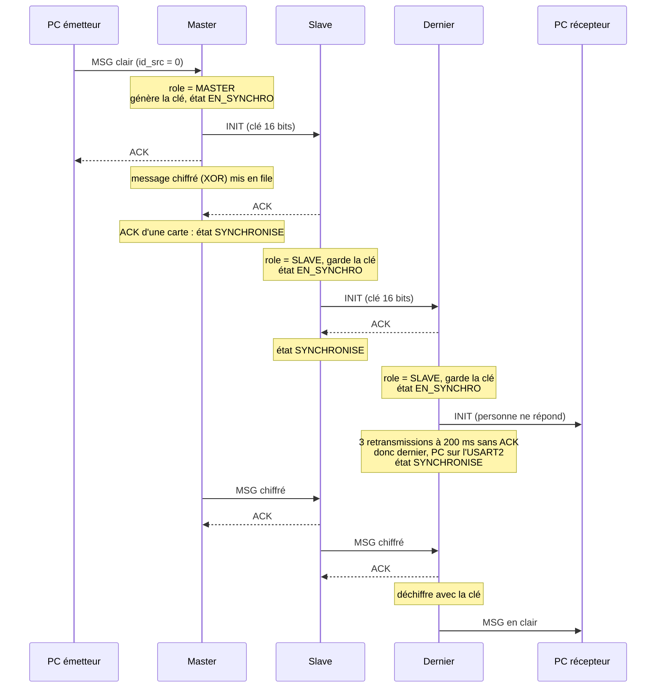
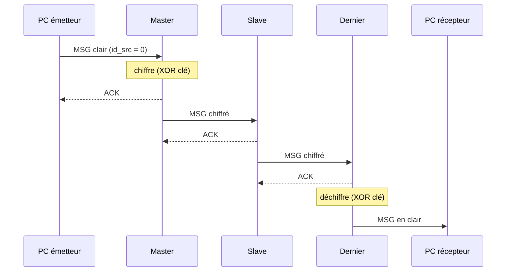
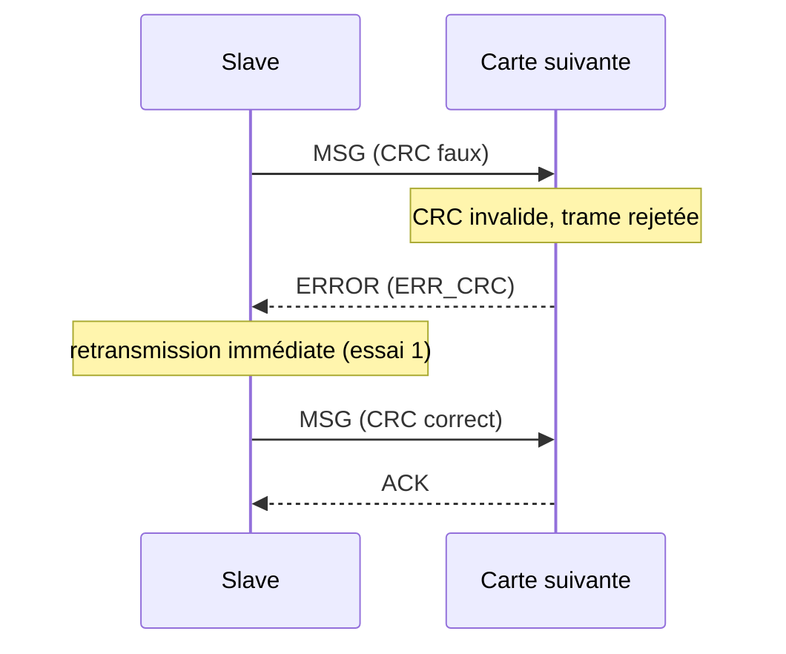
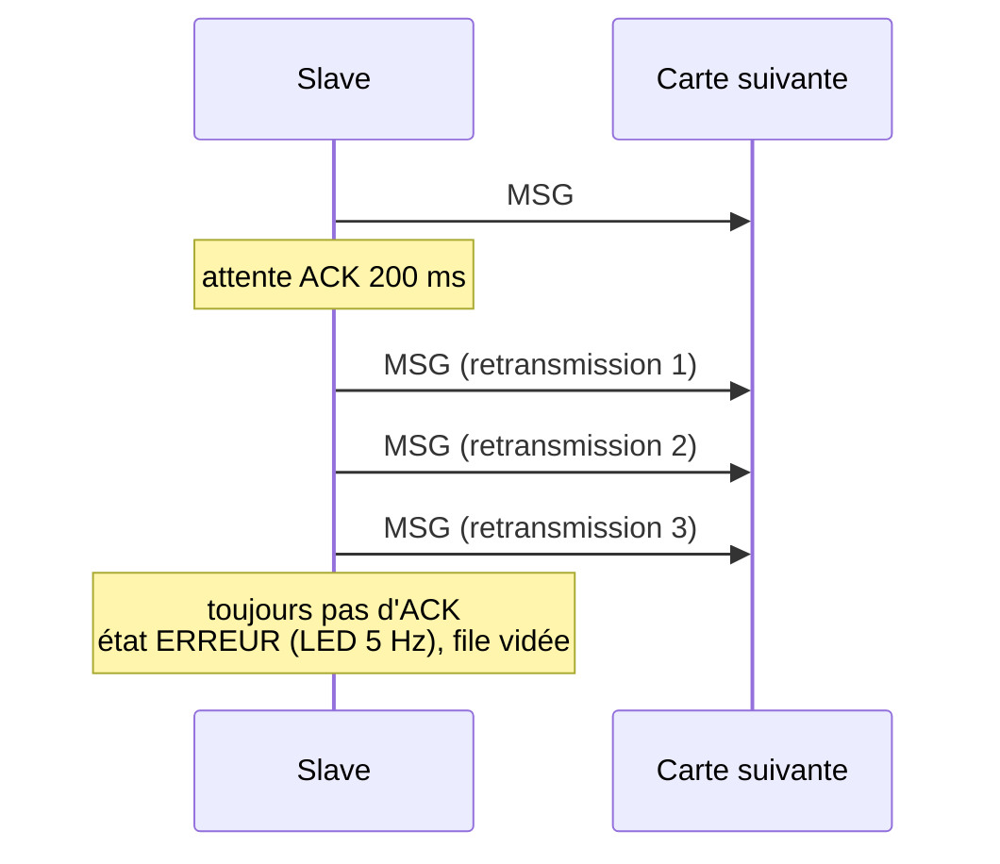
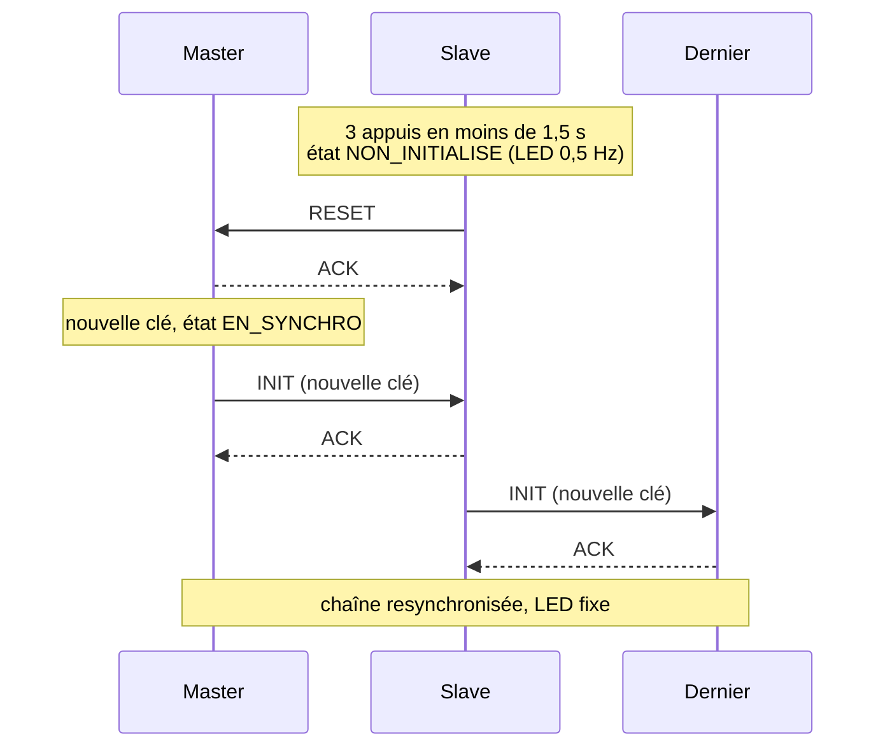
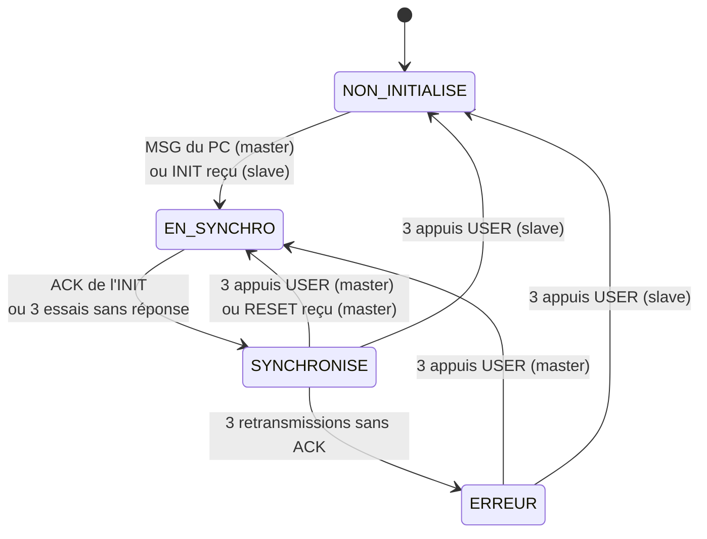

## Où apparaissent les logs

Les logs viennent de **`pc_chaine.c`**, côté PC émetteur et côté PC récepteur. Côté cartes, on observe la **LED** :

| État | LED |
|---|---|
| NON_INITIALISE (au démarrage) | 0,5 Hz |
| EN_SYNCHRO | 2 Hz |
| SYNCHRONISE | fixe |
| ERREUR | 5 Hz |

---

## 1. Cas nominaux

### 1er message, chaîne de 2 cartes ou plus

Le master répond ACK tout de suite. Le dernier nœud ne se reconnaît dernier qu'après 3 retransmissions sans réponse de l'INIT (200 ms × 4, soit environ 0,8 s). Le message arrive donc au récepteur avec ce retard.

```
[PC émetteur]
Tape un message puis Entree (Ctrl+D pour quitter)
-> envoye : "Bonjour"
   ACK du master (id 0x1A2B3C4D)

[PC récepteur, ~0,8 s plus tard]
En attente des messages de la derniere carte (Ctrl+C pour quitter)
<- message en clair de la carte 0x5E6F7A8B : "Bonjour"
```

Pendant ce temps, la LED des cartes passe de 0,5 Hz à 2 Hz puis à fixe. Le dernier nœud reste à 2 Hz environ 0,8 s, les autres presque pas.

### Messages suivants

Mêmes logs, mais le message arrive au récepteur quasi instantanément. Entre les cartes, le payload est chiffré (XOR) et il n'est déchiffré que par le dernier nœud.

### Message de plus de 16 caractères

Le message est découpé en trames de 16 octets :

```
-> envoye : "Bonjour tout le "
   ACK du master (id 0x1A2B3C4D)
-> envoye : "monde!"
   ACK du master (id 0x1A2B3C4D)

<- message en clair de la carte 0x5E6F7A8B : "Bonjour tout le "
<- message en clair de la carte 0x5E6F7A8B : "monde!"
```

---

## 2. Erreurs visibles sur le PC émetteur

| Situation | Log attendu | Remarque |
|---|---|---|
| Mauvais port, carte non flashée, câble débranché | `   pas de reponse du master (port ? carte flashee ?)` | après 3 s |
| PC branché sur un slave déjà dans la chaîne (ex. la dernière carte) | idem, aucune réponse | la trame est ignorée silencieusement |
| Master en ERREUR | `   ERREUR du master : carte pas synchronisee (en ERREUR : 3 appuis sur USER)` | résolu par 3 appuis sur USER |
| File d'attente pleine (4 messages) | `   ERREUR du master : file d'attente pleine` | |
| CRC invalide, length > 16, commande inconnue | `   ERREUR du master : CRC invalide` / `length > 16` / `commande inconnue` | `pc_chaine` ne produit jamais ces trames, seulement du bruit ou un autre outil |
| Réponse de la carte avec un CRC faux | `   reponse avec un CRC faux` | |
| Autre trame que ACK ou ERROR | `   reponse inattendue (commande N)` | |

---

## 3. Erreurs visibles sur le PC récepteur

| Situation | Log |
|---|---|
| Trame corrompue entre la dernière carte et le PC | `<- trame recue avec un CRC faux, ignoree` |
| La carte envoie autre chose qu'un MSG (ex. CMD_ERROR = 4 sur bruit) | `<- trame commande 4 de la carte 0x5E6F7A8B` |

---

## 4. Erreurs entre cartes 

| Situation | Comportement attendu |
|---|---|
| INIT sans réponse en aval | 3 retransmissions à 200 ms, puis la carte devient dernière : LED fixe, USART2 comme sortie PC |
| CRC invalide entre cartes | l'émetteur reçoit un CMD_ERROR et retransmet aussitôt (compte comme un essai) |
| length > 16 ou commande inconnue | rejet + CMD_ERROR, même traitement |
| MSG sans ACK après 3 retransmissions | l'émetteur passe en ERREUR (LED 5 Hz), file vidée, message perdu |
| Nœud intermédiaire en ERREUR | il répond ERR_ETAT à l'amont, qui passe en ERREUR à son tour, et ainsi de suite jusqu'au master |
| Header incomplet au bout de 50 ms | abandon silencieux, recherche du prochain `0x7E` |
| Payload/CRC incomplet au bout de 100 ms | idem |
| Octets parasites avant le `0x7E` | ignorés |
| Buffer RX plein (128 octets) | l'octet est perdu |

---

## 5. Bouton USER (3 appuis en moins de 1,5 s)

| Carte | Comportement | LED |
|---|---|---|
| Master | nouvelle clé, nouvel INIT sur toute la chaîne | 2 Hz puis fixe |
| Slave | passe en NON_INITIALISE et envoie un RESET vers l'amont. Le RESET remonte jusqu'au master, qui relance la synchro | 0,5 Hz, 2 Hz, puis fixe |
| Master en ERREUR | resynchronise la chaîne et sort de l'ERREUR | 5 Hz puis fixe |

Aucun log PC. Le message suivant doit simplement repasser avec un ACK.

---


## 6. Diagrammes de séquence

Exemple avec une chaîne de 3 cartes : Master, un Slave intermédiaire et la Dernière carte.

### 6.1 Premier message : synchronisation de la chaîne



Le dernier nœud ne sait qu'il est dernier qu'après environ 0,8 s, d'où le retard du premier message côté récepteur.

### 6.2 Message suivant (chaîne déjà synchronisée)



### 6.3 Erreur de CRC entre deux cartes



### 6.4 ACK perdu : retransmissions puis état ERREUR



Cas particulier : si la trame sans ACK est un INIT, la carte ne passe pas en ERREUR mais devient le dernier nœud (voir 7.1).

### 6.5 Trois appuis sur USER sur un Slave



Si le Slave n'est pas directement relié au Master, le RESET remonte de carte en carte (chacune répond ACK et le transmet à l'amont) jusqu'au Master.

### 6.6 États d'une carte

