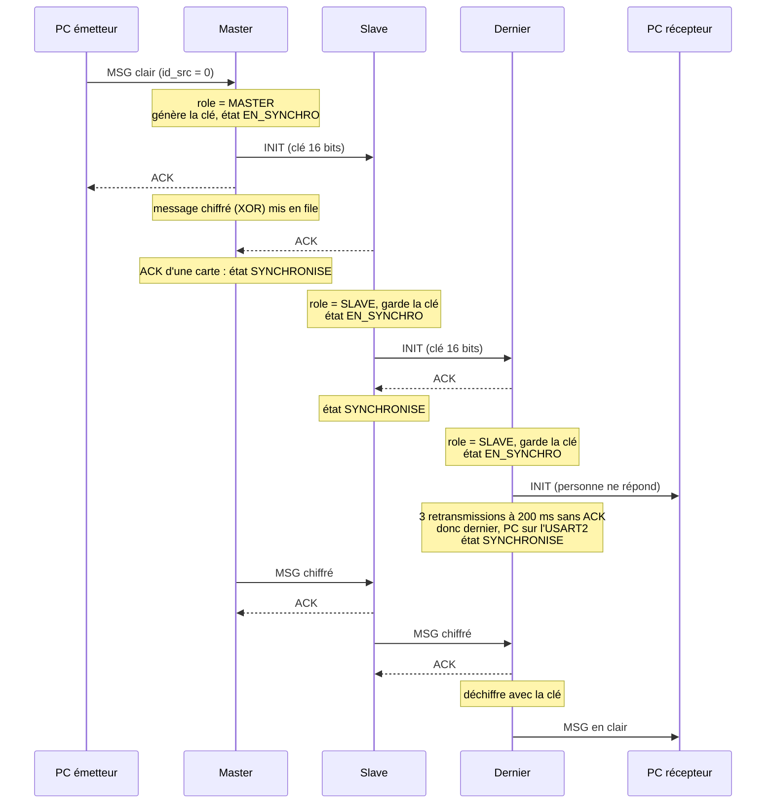
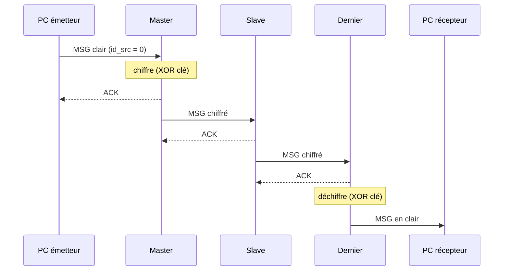
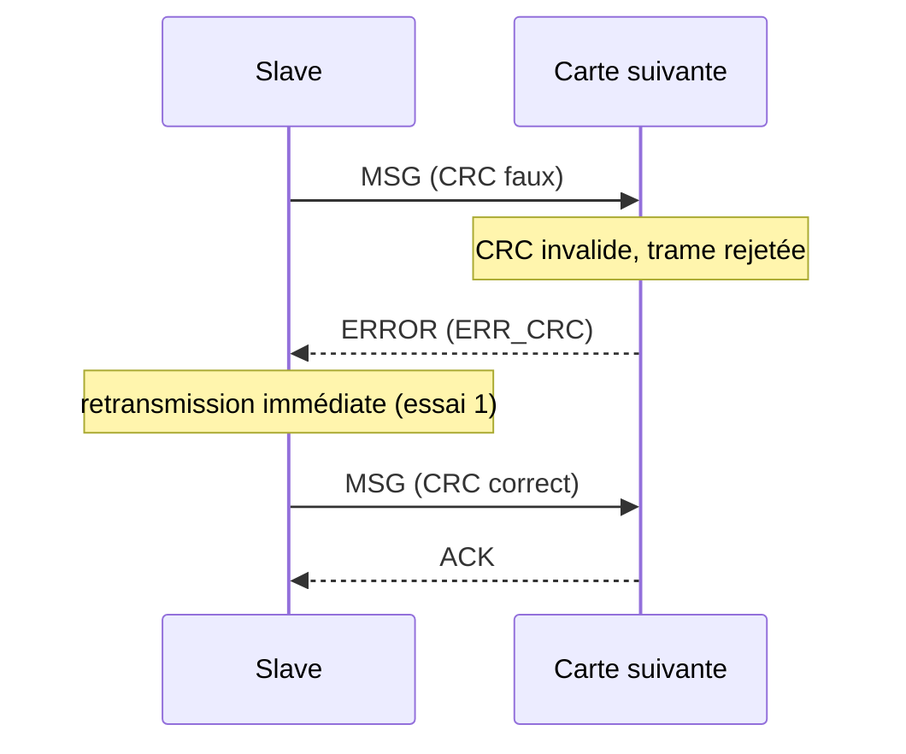
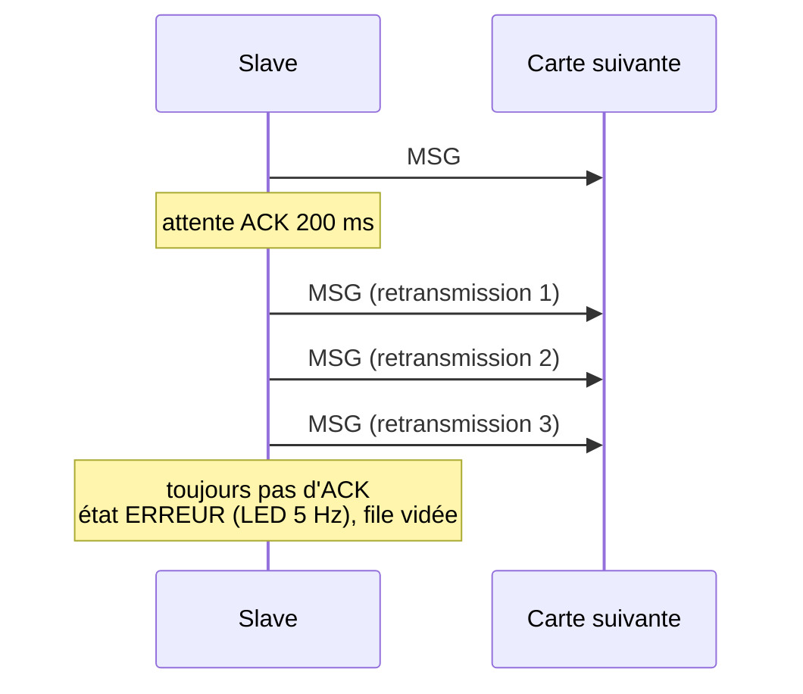
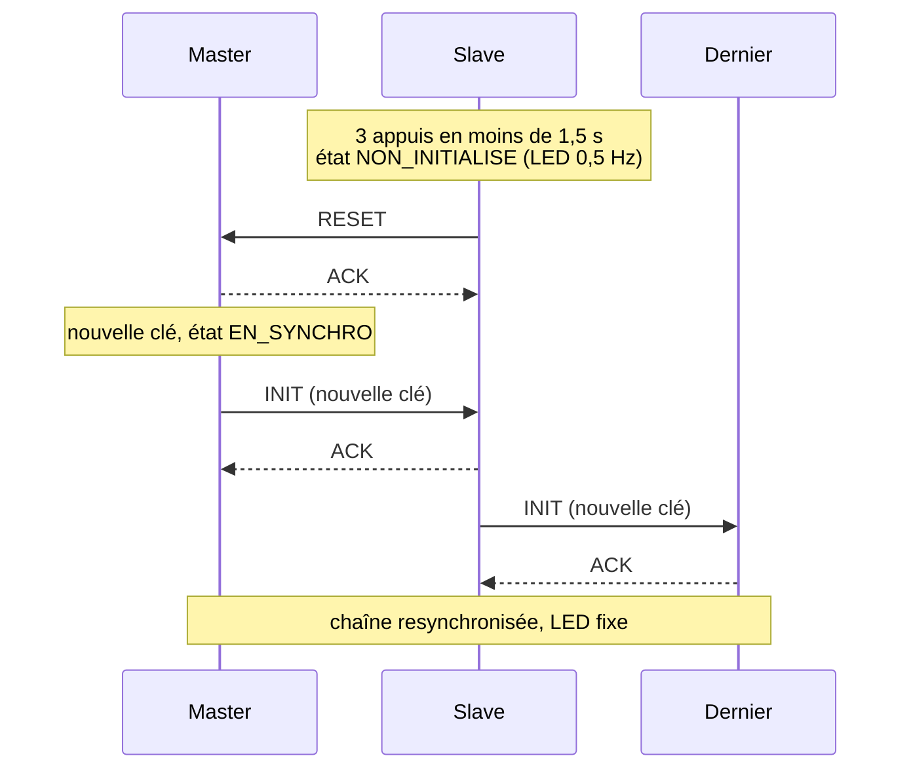
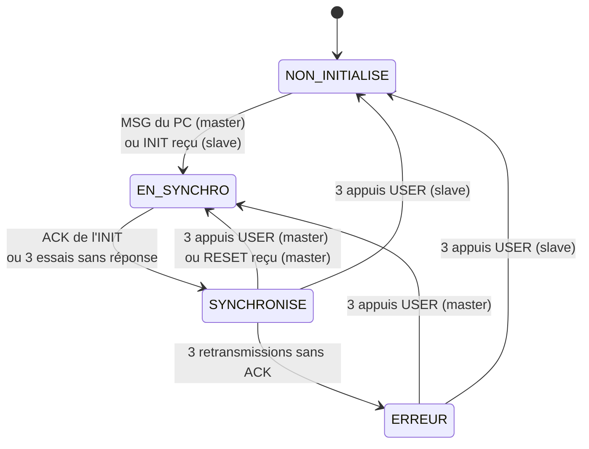

# Chaîne de cartes STM32 : transmission chiffrée de messages

Des cartes NUCLEO-F446RE sont reliées en chaîne par UART. Un PC émetteur envoie un message en clair à la première carte (le **master**). Le master génère une clé 16 bits, synchronise toute la chaîne, puis chiffre le message (XOR). Les cartes intermédiaires (**slaves**) le relaient. La **dernière carte** le déchiffre et l'envoie en clair à un PC récepteur.

Les exigences sont listées dans [`exigence.md`](exigence.md).

---

## Sommaire

1. [Matériel](#1-matériel)
2. [Montage](#2-montage)
3. [Lancer la démo](#3-lancer-la-démo)
4. [Format des trames](#4-format-des-trames)
5. [Cas nominaux](#5-cas-nominaux)
6. [Erreurs et comportements attendus](#6-erreurs-et-comportements-attendus)
7. [Bouton USER](#7-bouton-user-3-appuis-en-moins-de-15-s)
8. [Diagrammes de séquence](#8-diagrammes-de-séquence)
9. [Arborescence](#9-arborescence)

---

## 1. Matériel

- 2 cartes **NUCLEO-F446RE** ou plus
- 1 câble USB par carte (alimentation, flash et liaison série via le ST-Link)
- Des fils Dupont femelle-femelle (3 par liaison entre deux cartes)
- 1 ou 2 PC (Mac ou Linux) : un émetteur branché sur le master et un récepteur branché sur la dernière carte. Un seul PC avec deux terminaux convient aussi.

---

## 2. Montage

### 2.1 Rôle des UART

Toutes les cartes ont le **même firmware**. Le rôle (master, slave, dernière) est déterminé à l'exécution selon le branchement.

| UART | Broches | Connecteur | Relié à | Réglages |
|---|---|---|---|---|
| USART2 | PA2 (TX), PA3 (RX) | USB ST-Link (port COM virtuel) | PC | 115200 bauds, 8N1 |
| UART4 (aval) | **PC10** (TX), **PC11** (RX) | CN7-1, CN7-2 | carte suivante | 115200 bauds, 8N1 |
| UART5 (amont) | **PC12** (TX), **PD2** (RX) | CN7-3, CN7-4 | carte précédente | 115200 bauds, 8N1 |
| GND | GND | CN7-8 (ou CN7-19/20) | carte voisine | |

Autres broches utilisées : la LED LD2 (PA5) et le bouton USER B1 (PC13).

### 2.2 Câblage entre deux cartes

L'**UART4 (aval)** d'une carte se branche sur l'**UART5 (amont)** de la suivante, TX croisé avec RX, et avec une masse commune :

```
      Carte N                          Carte N+1
   (UART4, aval)                    (UART5, amont)

  PC10 TX  CN7-1  ───────────────►  CN7-4  PD2  RX
  PC11 RX  CN7-2  ◄───────────────  CN7-3  PC12 TX
  GND      CN7-8  ────────────────  CN7-8  GND
```

> La masse commune est indispensable : sans elle, les trames arrivent corrompues (CRC faux) ou pas du tout.

### 2.3 Chaîne complète (exemple à 3 cartes)

```
 ┌─────────────┐  USB   ┌──────────┐ UART4→UART5 ┌──────────┐ UART4→UART5 ┌──────────┐  USB   ┌─────────────┐
 │ PC émetteur │───────►│  Master  │────────────►│  Slave   │────────────►│ Dernière │───────►│ PC récepteur│
 └─────────────┘        └──────────┘             └──────────┘             └──────────┘        └─────────────┘
                     UART5 non branché                                UART4 non branché
```

- Le **master** est la carte qui reçoit un message du PC sur son USART2. Rien n'est branché sur son UART5.
- La **dernière carte** n'a rien sur son UART4. Elle s'en rend compte quand son INIT reste sans réponse (3 retransmissions à 200 ms), puis envoie les messages en clair sur son USART2.
- Les slaves intermédiaires sont alimentés par USB, mais aucun PC n'a besoin d'écouter leur port série.
- Les RX de l'UART4 et de l'UART5 ont une résistance de tirage interne : un port laissé en l'air ne génère pas de bruit.

> Variante : on peut brancher le PC récepteur directement sur l'UART4 de la dernière carte avec un adaptateur USB-série 3,3 V. Si le PC répond ACK à l'INIT avec `id_src = 0`, la carte se déclare dernière tout de suite et envoie les messages en clair sur l'UART4. `pc_chaine` ne gère pas ce cas : il faudrait un outil qui réponde ACK à l'INIT.

---

## 3. Lancer la démo

### 3.1 Compiler le programme PC

Les cartes doivent déjà être flashées avec le firmware (le même sur toutes).

`pc/pc_chaine.c` envoie et reçoit les trames au même format que les cartes. Même commande sur Mac et Linux, sur chacun des deux PC :

```bash
cc -Wall -o pc/pc_chaine pc/pc_chaine.c
```

### 3.2 Trouver le port série de la carte

| | Mac | Linux |
|---|---|---|
| Lister les ports | `ls /dev/tty.usbmodem*` | `ls /dev/ttyACM*` |
| Exemple | `/dev/tty.usbmodem14103` | `/dev/ttyACM0` |

Astuce : lancer la commande avant et après avoir branché la carte, le nouveau port est le bon.

### 3.3 Lancer

Exemple avec le **Linux en récepteur** (branché sur la dernière carte) et le **Mac en émetteur** (branché sur le master). Les rôles peuvent être inversés, seul le nom du port change.

1. Câbler la chaîne (section 2) et alimenter toutes les cartes : LED à 0,5 Hz.
2. **Sur le Linux (récepteur)**, en premier, pour ne pas manquer le premier message :

   ```bash
   ./pc/pc_chaine recevoir /dev/ttyACM0
   ```

3. **Sur le Mac (émetteur)** :

   ```bash
   ./pc/pc_chaine envoyer /dev/tty.usbmodem14103 "Bonjour"   # un seul message
   ./pc/pc_chaine envoyer /dev/tty.usbmodem14103             # mode interactif (Ctrl+D pour quitter)
   ```

4. Le premier message arrive au récepteur après environ 0,8 s (synchronisation, voir section 5). Les suivants arrivent immédiatement.

Pour arrêter : `Ctrl+C` côté récepteur, `Ctrl+D` côté émetteur en mode interactif.

> Si `Permission denied` sur Linux : ajouter l'utilisateur au groupe `dialout` avec `sudo usermod -aG dialout $USER`, puis se déconnecter / reconnecter.
> Si `Resource busy` : un autre programme (moniteur série, VS Code, `screen`) utilise déjà le port.

---

## 4. Format des trames

Défini dans [`Core/Src/protocol_icd.h`](Core/Src/protocol_icd.h), partagé par les cartes et le PC.

```
┌────────────┬─────────┬────────┬─────────┬──────────────┬─────────────────┬──────────┐
│ start 0x7E │ command │ length │ réservé │ id_src (4 o) │ payload (0..16) │ CRC (2 o)│
└────────────┴─────────┴────────┴─────────┴──────────────┴─────────────────┴──────────┘
 ◄──────────────────── header : 8 octets ────────────────►
```

| Champ | Détail |
|---|---|
| `command` | `0x00` INIT, `0x01` RESET, `0x02` ACK, `0x03` MSG, `0x04` ERROR |
| `length` | taille utile du payload, 16 max |
| `id_src` | identifiant de la carte (dérivé de l'UID du STM32), `0` = PC |
| payload INIT | clé 16 bits, poids faible d'abord |
| payload ERROR | code : `1` CRC, `2` length, `3` commande inconnue, `4` file pleine, `5` état (carte non synchronisée) |
| CRC | CRC-16/CCITT (poly `0x1021`, init `0xFFFF`) sur header + payload, poids faible d'abord |

Chiffrement : XOR octet par octet avec la clé (octets pairs avec l'octet faible, impairs avec l'octet fort).

---

## 5. Cas nominaux

Les logs viennent de `pc_chaine`, côté émetteur et côté récepteur. Côté cartes, on observe la **LED** :

| État | LED |
|---|---|
| NON_INITIALISE (au démarrage) | 0,5 Hz |
| EN_SYNCHRO | 2 Hz |
| SYNCHRONISE | fixe |
| ERREUR | 5 Hz |

### 5.1 Premier message, chaîne de 2 cartes ou plus

Le master répond ACK tout de suite. Le dernier nœud ne se reconnaît dernier qu'après 3 retransmissions sans réponse de l'INIT (200 ms × 4, soit environ 0,8 s). Le message arrive donc au récepteur avec ce retard.

```
[PC émetteur]
Tape un message puis Entree (Ctrl+D pour quitter)
-> envoye : "Bonjour"
   ACK du master (id 0x1A2B3C4D)

[PC récepteur, ~0,8 s plus tard]
En attente des messages de la derniere carte (Ctrl+C pour quitter)
<- message en clair de la carte 0x5E6F7A8B : "Bonjour"
```

Pendant ce temps, la LED des cartes passe de 0,5 Hz à 2 Hz puis à fixe. Le dernier nœud reste à 2 Hz environ 0,8 s, les autres presque pas.

### 5.2 Messages suivants

Mêmes logs, mais le message arrive au récepteur quasi instantanément. Entre les cartes, le payload est chiffré et il n'est déchiffré que par le dernier nœud.

### 5.3 Message de plus de 16 caractères

Le message est découpé en trames de 16 octets :

```
-> envoye : "Bonjour tout le "
   ACK du master (id 0x1A2B3C4D)
-> envoye : "monde!"
   ACK du master (id 0x1A2B3C4D)

<- message en clair de la carte 0x5E6F7A8B : "Bonjour tout le "
<- message en clair de la carte 0x5E6F7A8B : "monde!"
```

---

## 6. Erreurs et comportements attendus

### 6.1 Côté PC émetteur

| Situation | Log attendu | Remarque |
|---|---|---|
| Mauvais port, carte non flashée, câble débranché | `   pas de reponse du master (port ? carte flashee ?)` | après 3 s |
| PC branché sur un slave déjà dans la chaîne (ex. la dernière carte) | idem, aucune réponse | la trame est ignorée silencieusement |
| Master en ERREUR | `   ERREUR du master : carte pas synchronisee (en ERREUR : 3 appuis sur USER)` | résolu par 3 appuis sur USER |
| File d'attente pleine (4 messages) | `   ERREUR du master : file d'attente pleine` | |
| CRC invalide, length > 16, commande inconnue | `   ERREUR du master : CRC invalide` / `length > 16` / `commande inconnue` | `pc_chaine` ne produit jamais ces trames, seulement du bruit ou un autre outil |
| Réponse de la carte avec un CRC faux | `   reponse avec un CRC faux` | |
| Autre trame que ACK ou ERROR | `   reponse inattendue (commande N)` | |

### 6.2 Côté PC récepteur

| Situation | Log |
|---|---|
| Trame corrompue entre la dernière carte et le PC | `<- trame recue avec un CRC faux, ignoree` |
| La carte envoie autre chose qu'un MSG (ex. CMD_ERROR = 4 sur bruit) | `<- trame commande 4 de la carte 0x5E6F7A8B` |

### 6.3 Entre les cartes

| Situation | Comportement attendu |
|---|---|
| INIT sans réponse en aval | 3 retransmissions à 200 ms, puis la carte devient dernière : LED fixe, USART2 comme sortie PC |
| CRC invalide entre cartes | l'émetteur reçoit un CMD_ERROR et retransmet aussitôt (compte comme un essai) |
| length > 16 ou commande inconnue | rejet + CMD_ERROR, même traitement |
| MSG sans ACK après 3 retransmissions | l'émetteur passe en ERREUR (LED 5 Hz), file vidée, message perdu |
| Nœud intermédiaire en ERREUR | il répond ERR_ETAT à l'amont, qui passe en ERREUR à son tour, et ainsi de suite jusqu'au master |
| Header incomplet au bout de 50 ms | abandon silencieux, recherche du prochain `0x7E` |
| Payload/CRC incomplet au bout de 100 ms | idem |
| Octets parasites avant le `0x7E` | ignorés |
| Buffer RX plein (128 octets) | l'octet est perdu |

### 6.4 Problèmes de montage fréquents

| Symptôme | Cause probable |
|---|---|
| Toutes les cartes se déclarent dernières (LED fixe partout, rien au récepteur) | TX/RX non croisés, ou UART4 relié à l'UART4 au lieu de l'UART5 |
| ERREUR (5 Hz) dès le premier message, CRC faux en boucle | masse non commune entre les cartes |
| Le master ne répond pas | PC branché sur une autre carte que la première de la chaîne |

---

## 7. Bouton USER (3 appuis en moins de 1,5 s)

| Carte | Comportement | LED |
|---|---|---|
| Master | nouvelle clé, nouvel INIT sur toute la chaîne | 2 Hz puis fixe |
| Slave | passe en NON_INITIALISE et envoie un RESET vers l'amont. Le RESET remonte jusqu'au master, qui relance la synchro | 0,5 Hz, 2 Hz, puis fixe |
| Master en ERREUR | resynchronise la chaîne et sort de l'ERREUR | 5 Hz puis fixe |

Aucun log PC. Le message suivant doit simplement repasser avec un ACK.

---

## 8. Diagrammes de séquence

Exemple avec une chaîne de 3 cartes : Master, un Slave intermédiaire et la Dernière carte.

### 8.1 Premier message : synchronisation de la chaîne



Le dernier nœud ne sait qu'il est dernier qu'après environ 0,8 s, d'où le retard du premier message côté récepteur.

### 8.2 Message suivant (chaîne déjà synchronisée)



### 8.3 Erreur de CRC entre deux cartes



### 8.4 ACK perdu : retransmissions puis état ERREUR



Cas particulier : si la trame sans ACK est un INIT, la carte ne passe pas en ERREUR mais devient le dernier nœud (voir 8.1).

### 8.5 Trois appuis sur USER sur un Slave



Si le Slave n'est pas directement relié au Master, le RESET remonte de carte en carte (chacune répond ACK et le transmet à l'amont) jusqu'au Master.

### 8.6 États d'une carte



---

## 9. Arborescence

```
Core/Src/main.c           init des UART (USART2, UART4, UART5), LED et bouton
Core/Src/carte.c/.h       logique de la chaîne : rôles, synchro, relais, chiffrement, erreurs, LED, bouton
Core/Src/protocol_icd.h   format des trames (commun cartes / PC)
pc/pc_chaine.c            programme PC émetteur / récepteur
exigence.md               exigences du projet
Antholyne_project.ioc     projet STM32CubeMX
```
